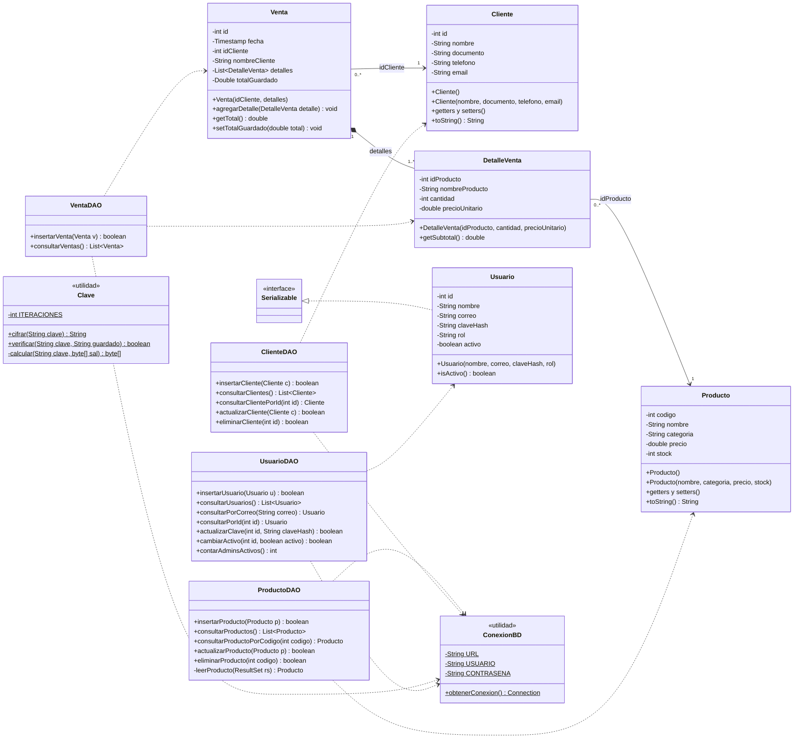

# Diagrama de clases — SIGEV_Web

Proyecto SIGEV (Sistema de Información para la Gestión de Ventas).
Aprendiz: Faber Stiven Londoño Gil · Ficha 3186610 · Guía de aprendizaje 8 (GA8-220501096).

**Versión actualizada:** describe el sistema tal como está construido hoy, reconstruido
a partir del código fuente de `src/java/com/sigev`. Se divide en dos vistas para que se
pueda leer: la capa de datos (modelo, DAO y utilidades) y la capa web (servicios REST,
filtros de seguridad y servlets de formulario).

Cómo leer las flechas (notación UML):

| Flecha | Significa | Ejemplo en SIGEV |
|---|---|---|
| `*--` (rombo relleno) | Composición: la parte no existe sin el todo | Una `Venta` tiene sus `DetalleVenta` |
| `-->` | Asociación: una clase guarda una referencia a otra | `DetalleVenta` apunta a un `Producto` por su código |
| `..>` (punteada) | Dependencia: una clase usa a otra en sus métodos | `ProductoDAO` usa `ConexionBD` |
| `<\|--` (triángulo) | Herencia: la clase extiende a otra | `ProductoApi` extiende `HttpServlet` |
| `<\|..` (triángulo punteado) | Realización: la clase implementa una interfaz | `Usuario` implementa `Serializable` |

Visibilidad: `-` privado, `+` público, `#` protegido. El `$` marca un miembro `static`.

## Vista 1: capa de datos

Notas de la vista 1:

- `Venta` y `DetalleVenta` existen en Java, pero en la base de datos no hay tabla
  `detalle_venta`: cada fila de la tabla `venta` es una línea (un producto).
  `VentaDAO.insertarVenta` guarda todas las líneas de una compra en una sola transacción
  y descuenta el stock con `UPDATE ... WHERE stock >= ?`; si a una línea le falta stock,
  deshace todo (rollback).
- `Venta` se relaciona con `Cliente` y `DetalleVenta` con `Producto` guardando el **id**,
  no el objeto completo. Por eso se dibujan como asociaciones y no como composición.
- `Usuario` es `Serializable` porque se guarda en la sesión de Tomcat. `claveHash` nunca
  sale en las respuestas de la API.
- `ConexionBD` lee las credenciales de `db.properties`, que no está en git.
- `Clave` cifra las contraseñas con PBKDF2-SHA256 y una sal aleatoria por usuario.

## Vista 2: capa web

```mermaid
classDiagram
    direction TB

    class HttpServlet {
        <<Jakarta EE>>
        #doGet(request, response) void
        #doPost(request, response) void
        #doPut(request, response) void
        #doDelete(request, response) void
    }

    class HttpFilter {
        <<Jakarta EE>>
        #doFilter(request, response, chain) void
    }

    class ProductoApi {
        <<REST /api/productos/*>>
        -ProductoDAO productoDAO
        #doGet()
        #doPost()
        #doPut()
        #doDelete()
        -validar(JsonObject json) String
    }
    class ClienteApi {
        <<REST /api/clientes/*>>
        -ClienteDAO clienteDAO
        #doGet()
        #doPost()
        #doPut()
        #doDelete()
        -validar(JsonObject json, int idActual) String
    }
    class VentaApi {
        <<REST /api/ventas/*>>
        -VentaDAO ventaDAO
        -ProductoDAO productoDAO
        -ClienteDAO clienteDAO
        #doGet()
        #doPost()
    }
    class LoginApi {
        <<REST /api/login>>
        -int MAX_INTENTOS$
        -Map intentos
        #doPost()
        -estaBloqueado(String correo) boolean
        -registrarFallo(String correo) void
    }
    class SesionApi {
        <<REST /api/sesion, /api/logout>>
        #doGet()
        #doPost()
    }
    class RegistroApi {
        <<REST /api/registro>>
        #doPost()
    }
    class UsuarioApi {
        <<REST /api/usuarios/*>>
        #doGet()
        #doPut()
    }
    class CambiarClaveApi {
        <<REST /api/cambiar-clave>>
        #doPost()
        ~validarNueva(nueva, actual, correo)$ String
    }

    class ProductoServlet {
        <<form /ProductoServlet>>
        #doGet()
        #doPost()
    }
    class ClienteServlet {
        <<form /ClienteServlet>>
        #doGet()
        #doPost()
    }
    class VentaServlet {
        <<form /VentaServlet>>
        #doGet()
        #doPost()
    }

    class CabecerasFilter {
        <<filtro 1: /*>>
    }
    class CorsFilter {
        <<filtro 2: /api/*>>
    }
    class SeguridadFilter {
        <<filtro 3: /api/*>>
        -recursoDe(request) String
        -esJson(request) boolean
    }
    class PaginasFilter {
        <<filtro: JSP y formularios>>
        -Map RECURSO$
    }

    class Permisos {
        <<reglas por rol>>
        +String ADMIN$
        +String VENDEDOR$
        +permitido(rol, metodo, recurso)$ boolean
    }
    class ApiUtil {
        <<utilidad>>
        +usuarioVigente(request)$ Usuario
        +leerJson(request)$ JsonObject
        +responder(response, estado, datos)$ void
        +error(response, estado, mensaje)$ void
        +idDeRuta(request)$ Integer
        +correoValido(String correo)$ boolean
    }

    HttpServlet <|-- ProductoApi
    HttpServlet <|-- ClienteApi
    HttpServlet <|-- VentaApi
    HttpServlet <|-- LoginApi
    HttpServlet <|-- SesionApi
    HttpServlet <|-- RegistroApi
    HttpServlet <|-- UsuarioApi
    HttpServlet <|-- CambiarClaveApi
    HttpServlet <|-- ProductoServlet
    HttpServlet <|-- ClienteServlet
    HttpServlet <|-- VentaServlet

    HttpFilter <|-- CabecerasFilter
    HttpFilter <|-- CorsFilter
    HttpFilter <|-- SeguridadFilter
    HttpFilter <|-- PaginasFilter

    SeguridadFilter ..> Permisos
    PaginasFilter ..> Permisos
    SeguridadFilter ..> ApiUtil
    PaginasFilter ..> ApiUtil
    RegistroApi ..> CambiarClaveApi : validarNueva
```

Notas de la vista 2:

- Todos los servicios REST usan `ApiUtil` para leer y responder JSON (con Gson). Esas
  flechas no se dibujan para no llenar el diagrama.
- Cada servicio usa los DAO de la vista 1: `ProductoApi` y `ProductoServlet` usan
  `ProductoDAO`; `ClienteApi` y `ClienteServlet` usan `ClienteDAO`; `VentaApi` y
  `VentaServlet` usan `VentaDAO`, `ProductoDAO` y `ClienteDAO`; `LoginApi`, `RegistroApi`,
  `UsuarioApi`, `CambiarClaveApi` y `ApiUtil` usan `UsuarioDAO`.
- `LoginApi`, `RegistroApi` y `CambiarClaveApi` usan `Clave` para cifrar y verificar
  contraseñas.
- El orden de los filtros lo define `web.xml`, no las anotaciones: primero
  `CabecerasFilter` (cabeceras de seguridad), luego `CorsFilter` y luego `SeguridadFilter`
  (401 sin sesión, 403 sin permiso, 415 si no es JSON).
- Las reglas de qué puede hacer cada rol están solo en `Permisos`. Un recurso que no
  aparece allí queda solo para Admin (seguro por defecto).
- `<<...>>` es un estereotipo: aquí indica la ruta que atiende cada clase.
