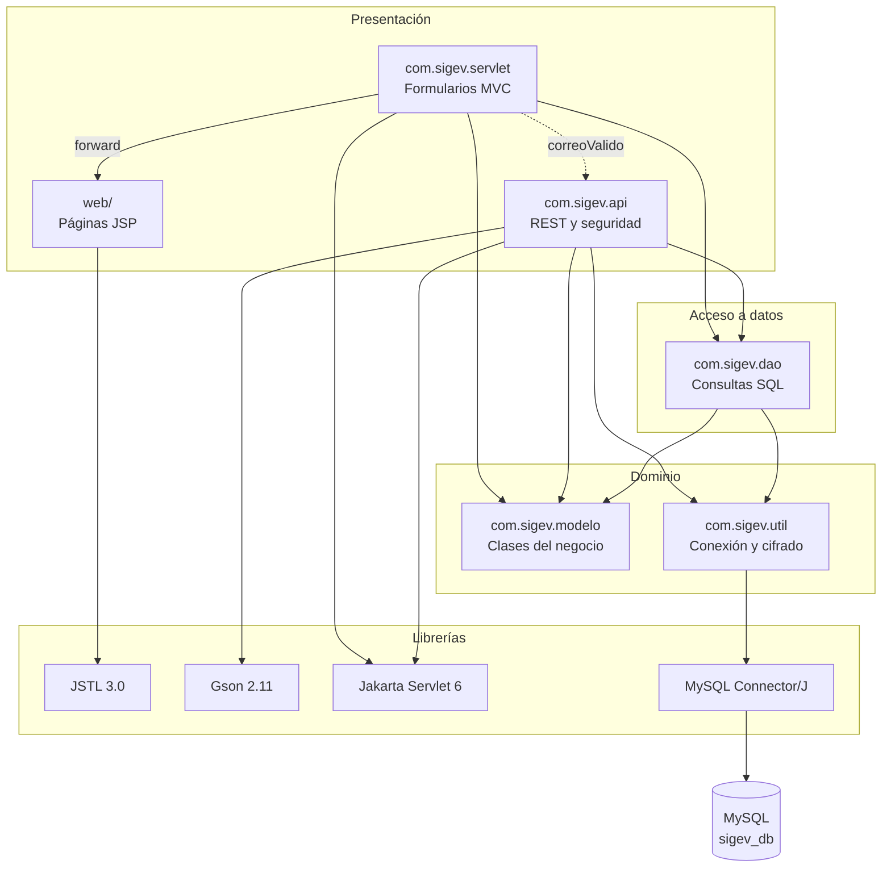

# Diagrama de paquetes — SIGEV_Web

Proyecto SIGEV (Sistema de Información para la Gestión de Ventas).
Aprendiz: Faber Stiven Londoño Gil · Ficha 3186610 · Guía de aprendizaje 8 (GA8-220501096).

**Versión actualizada:** describe cómo está organizado hoy el código de `SIGEV_Web`,
reconstruido a partir de los `import` de cada clase.

Cada caja es un paquete (una carpeta de código). Una flecha de A hacia B significa
"A depende de B": A usa clases de B, así que si B cambia, A puede verse afectado.
Las dependencias van siempre de arriba (lo que ve el usuario) hacia abajo (los datos),
nunca al revés. Por eso se dice que la aplicación está organizada **en capas**.

Las clases de cada paquete están en la tabla de abajo y en el diagrama de clases.

## Qué hace cada paquete

| Paquete | Responsabilidad | Depende de |
|---|---|---|
| `com.sigev.api` | Recibe peticiones HTTP del front-end en React, valida, aplica la seguridad (sesión, rol, cabeceras) y responde JSON | `dao`, `modelo`, `util`, Gson, Jakarta |
| `com.sigev.servlet` | Atiende los formularios de las páginas JSP (evidencias AA2 y AA3) y reenvía (forward) a la vista | `dao`, `modelo`, `api` (solo `ApiUtil`), Jakarta |
| `com.sigev.dao` | Lee y escribe en MySQL con `PreparedStatement`. Cada método abre su propia conexión | `modelo`, `util` |
| `com.sigev.modelo` | Clases simples (POJO) que representan los datos del negocio | Nada |
| `com.sigev.util` | Conexión a la base de datos (lee `db.properties`) y cifrado de contraseñas (PBKDF2) | Driver de MySQL |
| `web/` | Vistas JSP; todo valor de la base de datos se muestra con `<c:out>` para evitar XSS | JSTL |

## Observaciones

- **`modelo` no depende de nadie.** Es lo más estable del sistema: si mañana se cambia
  la base de datos o la interfaz, las clases del negocio no cambian.
- **La seguridad vive en `api`.** `PaginasFilter` también protege las páginas JSP y los
  servlets de formulario, aunque esté en el paquete `api`, para que ambas puertas de
  entrada usen las mismas reglas de `Permisos`.
- **Una dependencia a mejorar.** `servlet` usa `ApiUtil.correoValido` de `api` para
  validar correos. Funciona, pero lo ideal sería mover esa validación a `util` para que
  los servlets no dependan de la capa REST.
- **El front-end en React** (`SIGEV_Front`) es otro proyecto y no aparece aquí: se
  comunica con `com.sigev.api` por HTTP en `http://localhost:8080/SIGEV_Web/api/...`.
  Eso se verá en el diagrama de componentes.
