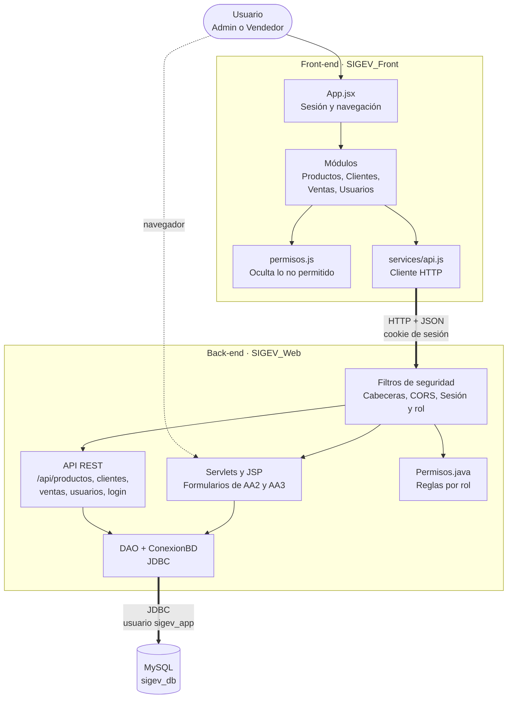
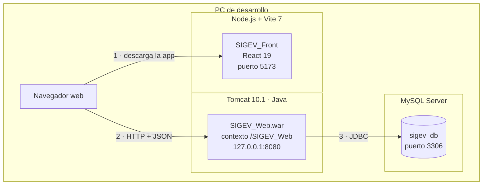

# Diagrama de componentes y arquitectura — SIGEV

Proyecto SIGEV (Sistema de Información para la Gestión de Ventas).
Aprendiz: Faber Stiven Londoño Gil · Ficha 3186610 · Guía de aprendizaje 8 (GA8-220501096).

**Versión actualizada:** describe el sistema tal como está construido hoy, reconstruido a
partir del código de `SIGEV_Front` (React) y `SIGEV_Web` (Java) y de su configuración.

Un **componente** es una pieza del sistema que se puede reemplazar sin rehacer las demás,
siempre que respete la misma interfaz (la forma de comunicarse). Por ejemplo, el front-end
en React podría cambiarse por una app Android, y la API no tendría que cambiar, porque
ambos hablan el mismo idioma: peticiones HTTP con JSON.

## Vista 1: componentes

### Interfaces entre componentes

| De | A | Cómo se comunican |
|---|---|---|
| Usuario | Front-end | Navegador web en `http://localhost:5173` |
| `services/api.js` | API REST | HTTP con JSON en `http://localhost:8080/SIGEV_Web/api/...`, enviando la cookie de sesión (`credentials: 'include'`) |
| API REST | Front-end | Respuestas JSON. Los errores llegan como `{"error": "mensaje"}` con su código HTTP (400, 401, 403, 404, 409, 415, 500) |
| Usuario | Servlets y JSP | Navegador directo a `http://localhost:8080/SIGEV_Web/`, protegido por `PaginasFilter` |
| DAO | MySQL | JDBC con `PreparedStatement`, como el usuario `sigev_app` |

### Responsabilidad de cada componente

| Componente | Hace | No hace |
|---|---|---|
| `App.jsx` | Guarda quién inició sesión y qué módulo se ve; muestra el login o la página de error 401/403 | No guarda contraseñas |
| Módulos React | Cada uno junta un formulario (`*Form`) y una tabla (`*Lista`) | No hablan con el servidor directamente: todo pasa por `api.js` |
| `permisos.js` | Oculta botones y menús que el rol no puede usar | **No protege nada**: es solo comodidad visual |
| `services/api.js` | Arma cada petición, envía la cookie y avisa a la app cuando llega un 401 o 403 | — |
| Filtros de seguridad | Agregan cabeceras de seguridad, aceptan solo el origen del front-end, exigen sesión vigente y rol permitido | — |
| `Permisos.java` | Único lugar con las reglas por rol. Lo no listado queda solo para Admin | — |
| API REST | Valida los datos, aplica las reglas del negocio y responde JSON | No confía en el precio que manda el cliente: lo lee de la base de datos |
| DAO + `ConexionBD` | Consultas parametrizadas y transacciones | No arma SQL concatenando texto |
| MySQL | Guarda productos, clientes, ventas y usuarios | — |

## Vista 2: arquitectura y despliegue

Muestra **dónde corre** cada componente. Hoy todo corre en el computador del
desarrollador (ambiente de desarrollo y pruebas).

| Nodo | Software | Configuración relevante |
|---|---|---|
| Navegador | Cualquier navegador moderno | Ejecuta la app React descargada de Vite |
| Node.js + Vite | Vite 7 (servidor de desarrollo) | `npm run dev` en `SIGEV_Front/sigev-front`, puerto 5173 |
| Tomcat | Apache Tomcat 10.1, Jakarta EE 10 | Escucha solo en `127.0.0.1:8080` (no visible en la red local). Sin páginas de error con versión del servidor. Sin las apps de ejemplo `examples` y `docs` |
| MySQL | MySQL Server, base `sigev_db` | La app entra como `sigev_app`, que solo puede `SELECT`, `INSERT`, `UPDATE` y `DELETE`. `root` queda solo para el administrador en Workbench |

### Seguridad por capas (defensa en profundidad)

1. **Navegador:** la cookie de sesión es `HttpOnly` (JavaScript no la puede leer) y
   `SameSite=Strict` (otro sitio no la puede usar).
2. **Cabeceras:** `CabecerasFilter` impide meter SIGEV en un marco de otra página y evita
   que el navegador guarde en caché datos de clientes y ventas.
3. **Origen:** `CorsFilter` solo acepta peticiones desde `http://localhost:5173`.
4. **Sesión y rol:** `SeguridadFilter` relee el usuario en la base de datos en cada
   petición; si fue desactivado, queda fuera al instante.
5. **Datos:** consultas parametrizadas, contraseñas con PBKDF2 y credenciales de MySQL
   en `db.properties`, fuera de git.

### Ambiente de pruebas

No existe todavía un servidor de pruebas separado ni una URL pública: las pruebas se
hacen en el mismo PC. Para entregar URLs de despliegue (lo pide la evidencia
GA8-220501096-AA1-EV02) habría que publicar Tomcat y MySQL en un servidor con HTTPS.
